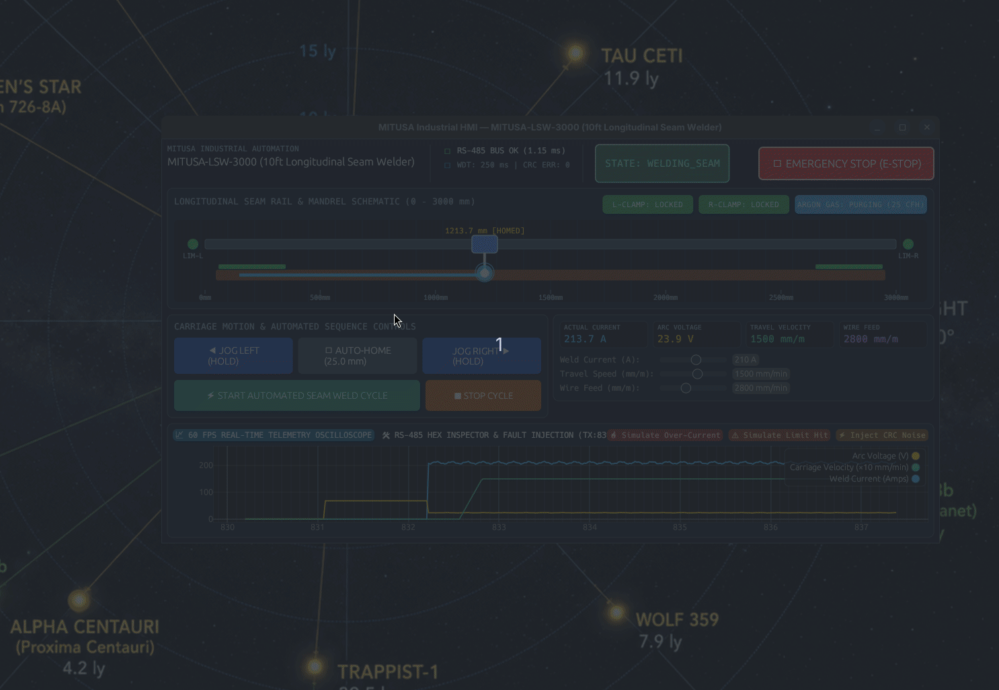
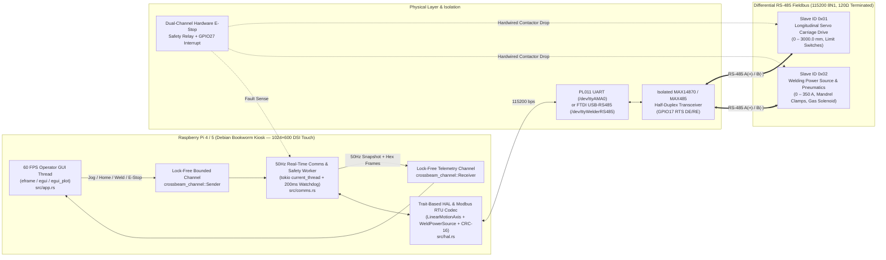

# `seam-weld-hmi-rs` — Industrial Longitudinal Seam Welder Touchscreen HMI (Rust)

[](#)
[-C51A4A?logo=raspberrypi)](#)
[-0066CC)](#)
[](#)

<p align="center">
  
</p>

Production-grade **Embedded Linux (Raspberry Pi 4/5) Touchscreen HMI** written in **Rust (`eframe`/`egui` + `tokio`)** for **Automated Longitudinal Seam Welders** (3000 mm linear carriage rail, pneumatic copper backing mandrel clamps, argon shielding gas purge control, and constant-current TIG/MIG welding power source orchestration).

Designed to run out-of-the-box on any developer workstation (`cargo run --release`) using a **deterministic internal RS-485 physics loopback**, or connected via UART / `socat` to the companion **C++17 Hardware-in-the-Loop (HIL) Servo & Welder Emulator** (`sim/servo_weld_emulator.cpp`).

---

## 1. System Architecture Diagram



---

## 2. Electrical Pinout & Wiring Schematic (Raspberry Pi 4/5 40-Pin Header)

| RPi Header Pin | BCM GPIO | Signal Name | Direction | Connected Hardware Terminal | Electrical Notes & Protection |
| :---: | :---: | :--- | :---: | :--- | :--- |
| **Pin 02 / 04** | `5V Power` | `+5V_SYS` | Output | Isolated DC-DC Converter Input | Powers logic side of isolated RS-485 transceiver (2.5 kVrms galvanic isolation) |
| **Pin 06 / 09** | `GND` | `LOGIC_GND` | Common | Logic Ground Reference | Isolated from welding chassis ground to prevent HF arc-strike ground loops |
| **Pin 08** | `GPIO 14` | `UART0_TXD` | Output (3.3V) | MAX485 `DI` (Driver Input) | PL011 Hardware UART (`/dev/ttyAMA0`), 115200 baud, 8N1 |
| **Pin 10** | `GPIO 15` | `UART0_RXD` | Input (3.3V) | MAX485 `RO` (Receiver Output) | Schmitt-trigger buffered with 10 kΩ pull-up to 3.3V |
| **Pin 11** | `GPIO 17` | `UART0_RTS` | Output (3.3V) | MAX485 `DE` & `/RE` (Tied) | Hardware-controlled RS-485 half-duplex direction (`gpio-rts` overlay) |
| **Pin 13** | `GPIO 27` | `ESTOP_SENSE_N` | Input (Opto) | Pilz PNOZ Safety Relay Aux Contact | Active-low opto-isolated sense input; triggers immediate software `FAULT_ESTOP` |
| **Pin 15** | `GPIO 22` | `WDT_HEARTBEAT` | Output (3.3V) | External Hardware Supervisor | Toggled at 50 Hz by `comms.rs`; drops enable relay if Linux kernel hangs |
| **RS-485 Bus** | `Diff Pair` | `RS485_A+ / B-` | Bi-Dir | Servo Drive (`0x01`) & Welder (`0x02`) | Belden 9841 shielded twisted pair, **120 Ω** termination at both ends, TVS diodes |

```text
  Raspberry Pi 4/5 (PL011)         Galvanic Isolation            RS-485 Multipoint Fieldbus (120Ω Terminated)
┌──────────────────────────┐     ┌────────────────────┐        ┌──────────────────────────────────────────────┐
│ GPIO14 (Pin 08) UART_TXD ├────►│ DI              A+ ├───────┬┼───────► [Slave 0x01] Servo Carriage Drive    │
│ GPIO17 (Pin 11) UART_RTS ├────►│ DE / RE         B- ├─────┐ │├───────► [Slave 0x02] Weld Power + Pneumatics │
│ GPIO15 (Pin 10) UART_RXD │◄────┤ RO        MAX14870 │     │ ││                                              │
│ GPIO27 (Pin 13) ESTOP_IN │◄────┤ Opto-24V   RS-485  │     └─┼┴─[120Ω]─ Shielded Twisted Pair (Belden 9841)  │
└──────────────────────────┘     └────────────────────┘       └───────────────────────────────────────────────┘
```

---

## 3. Safety Architecture Overview

Industrial seam welding systems combine high-current plasma arcs (up to **350 A**) with high-torque linear servo motion across a **3000 mm** carriage rail and high-frequency (HF) arc-strike EMI. This HMI enforces four layers of defense-in-depth:

1. **Dual-Thread Non-Blocking Execution (`src/app.rs` $\leftrightarrow$ `src/comms.rs`):**
   - The `egui` touchscreen interface runs strictly on the rendering thread at **60 FPS** and communicates with the hardware worker exclusively through lock-free bounded `crossbeam_channel` queues.
   - Serial timeouts, bus retries, or CRC faults on the **50 Hz real-time worker thread** can **never** freeze the operator's **EMERGENCY STOP** button on screen.
2. **200 ms Hardware Watchdog / Jog Heartbeat Timer (`src/comms.rs`):**
   - When an operator holds **JOG LEFT** or **JOG RIGHT**, the GUI dispatches continuous `HmiCommand::JogHeartbeat` keep-alive ticks.
   - If the GUI thread stalls, loses touch focus, or fails to deliver a heartbeat within **200 ms** (`watchdog_timeout_ms = 200`), the 50 Hz control thread autonomously transmits an emergency zero-velocity halt (`0x00FF`) to the servo drive and transitions the state machine to `FAULT_ESTOP`.
   - Includes a dedicated **"TEST 200ms WATCHDOG TRIP"** button in the Technician Diagnostics tab so reviewers can verify the watchdog trip live.
3. **Deterministic Modbus RTU Framing & CRC-16 Validation (`src/hal.rs`):**
   - Every outgoing and incoming RS-485 frame is validated against the standard `CRC-16/MODBUS` polynomial (`0xA001`).
   - Any corrupted response caused by HF TIG arc initiation noise is rejected before mutating telemetry, logged in the live **RS-485 Hex Frame Inspector**, and safely trips the machine to `FAULT_ESTOP`.
4. **Hardware Interlock Enforcement & State Machine Gating:**
   - The automated weld sequence (`IDLE` $\rightarrow$ `CLAMPING` $\rightarrow$ `ARC_STRIKE` $\rightarrow$ `WELDING_SEAM`) verifies that both Left and Right Pneumatic Mandrel Clamps are locked and Argon pre-flow purge has completed before commanding an arc strike or carriage motion.

---

## 4. Quick Start Instructions

### Option A: Immediate Desktop Simulation (Built-in Physics Loopback)
No physical serial hardware is required. When `/dev/ttyAMA0` is absent, the HMI automatically engages its deterministic internal RS-485 physics & arc simulator:

```bash
# 1. Verify unit tests (Modbus RTU framing & CRC-16 validation)
cargo test

# 2. Launch the 1024x600 Industrial Touchscreen HMI
cargo run --release
```

**What to try inside the GUI:**
- Click **⚡ START AUTOMATED SEAM WELD CYCLE** to watch the machine lock the pneumatic mandrel clamps, purge Argon shielding gas, strike an arc, and traverse the 3000 mm rail while plotting live 60 FPS Weld Current, Arc Voltage, and Carriage Velocity.
- Hold **◀ JOG LEFT** or **JOG RIGHT ▶** to jog the carriage manually, or click **⌂ AUTO-HOME** to home to `25.0 mm`.
- Switch the bottom panel to **🛠 RS-485 HEX INSPECTOR & FAULT INJECTION** to inspect live raw Modbus RTU hex frames (`[01 03 00 10 00 03 04 0E]`) and test **Simulate Over-Current**, **Simulate Limit Hit**, **Inject CRC Noise**, or **Test 200ms Watchdog Trip**.

---

### Option B: Hardware-in-the-Loop (HIL) Test with the C++17 Emulator (`socat`)
To verify full end-to-end UART serialization across Linux pseudo-terminals (`pty`) against the standalone C++17 hardware emulator:

```bash
# 1. Compile the standalone C++17 Servo + Welder Modbus RTU Emulator
g++ -std=c++17 -O2 -Wall -Wextra -pedantic sim/servo_weld_emulator.cpp -o sim/servo_weld_emulator

# 2. Run the built-in C++ Modbus RTU self-test
./sim/servo_weld_emulator --self-test

# 3. Create a virtual RS-485 serial pair using socat (note the two /dev/pts/X paths printed)
socat -d -d pty,raw,echo=0 pty,raw,echo=0

# 4. In Terminal 2: Start the C++17 Hardware Emulator on the first PTY
./sim/servo_weld_emulator /dev/pts/3

# 5. In Terminal 3: Launch the Rust HMI attached to the second PTY
cargo run --release -- --serial /dev/pts/4
```

---

### Option C: Embedded Debian Bookworm Deployment (Raspberry Pi 4/5)
```bash
# Install deterministic udev symlink (/dev/ttyWelderRS485) & 1ms FTDI latency rule
sudo cp deploy/99-rs485-welder.rules /etc/udev/rules.d/
sudo udevadm control --reload-rules && sudo udevadm trigger

# Install & enable the real-time systemd Kiosk service
sudo cp deploy/seam-hmi.service /etc/systemd/system/
sudo systemctl daemon-reload
sudo systemctl enable --now seam-hmi.service
```
